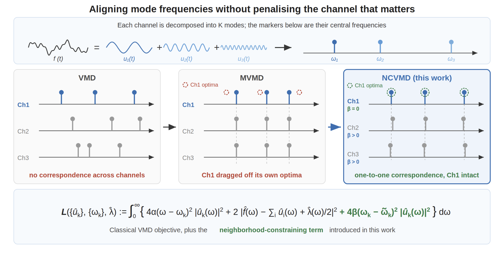

# Neighborhood-Constrained Variational Mode Decomposition (NCVMD)

**VMD**, **MVMD**, **NCVMD**, and **VMDMS** (decomposition step) in Python, with a built-in synthetic **toy example** for reconstruction tests.

No electric-load datasets or external data files are required.

## Author and license

This repository is maintained by **Paolo Fazzini**. Unless noted otherwise in individual files, code is released under the **[MIT License](LICENSE)** (permissive use, modification, and redistribution with attribution and license notice).

The VMD implementations in `VMD_pers.py` and `VMD_extended.py` build on the Python VMD code by Vinícius Rezende Carvalho (see file headers and cite Dragomiretskiy & Zosso, 2014, when using standard VMD). NCVMD, VMDMS-related code, MVMD integration, and this supplement layout are part of this repository’s contributions.

## NCVMD at a glance

Aligning mode frequencies across channels without penalising the channel that matters (VMD vs MVMD vs NCVMD):



## Contents

| File | Role |
|------|------|
| `VMD_pers.py` | VMD (extended implementation used in the project) |
| `VMD_extended.py` | VMD with coupling term (used by NCVMD) |
| `mvmd.py` | MVMD |
| `ncvmd.py` | NCVMD |
| `vmdms.py` | VMDMS decomposition (independent VMD per channel; frequency partitioning for forecasting is not included here) |
| `toy_data.py` | Synthetic signals `Test_1D` and `Artificial2D_1` |
| `test_toy_example.py` | Reconstruction test on toy data |

## Requirements

- Python 3.8+
- `numpy` (see `requirements.txt`)

## Running the test

```bash
pip install -r requirements.txt
python test_toy_example.py
```

Univariate toy signal:

```bash
python test_toy_example.py --dataset Test_1D
```

The script prints per-channel reconstruction RMSE for each method. It does not require TensorFlow or external datasets.

## Citation

If you use code from this repository in academic work, please cite the relevant publication(s) below.

### NCVMD

If you use **NCVMD**, please cite:

> **TODO:** NCVMD reference to be added (author will provide BibTeX / DOI).

```bibtex
% TODO: NCVMD — replace with the official BibTeX entry when available.
@article{ncvmd_todo,
  author  = {},
  title   = {},
  journal = {},
  year    = {},
  doi     = {}
}
```

### VMDMS

If you use **VMDMS**, please cite:

> Fazzini, P., La Tona, G., Diez, M. & Di Piazza, M. C. Enhanced forecasting of shipboard electrical power demand using multivariate input and variational mode decomposition with mode selection. *Scientific Reports* **15**, 23941 (2025). https://doi.org/10.1038/s41598-025-06153-z

```bibtex
@article{Fazzini2025VMDMS,
  author  = {Fazzini, Paolo and La Tona, Giuseppe and Diez, Matteo and {Di Piazza}, Maria Carmela},
  title   = {Enhanced forecasting of shipboard electrical power demand using multivariate input and variational mode decomposition with mode selection},
  journal = {Scientific Reports},
  volume  = {15},
  pages   = {23941},
  year    = {2025},
  doi     = {10.1038/s41598-025-06153-z},
  url     = {https://doi.org/10.1038/s41598-025-06153-z}
}
```

Standard **VMD** and **MVMD** implementations here follow the literature cited in the module docstrings (Dragomiretskiy & Zosso, 2014, and the respective multivariate references). Cite those original papers when you rely on the base algorithms.

## Related work

- **VMDMS** (earlier public toy / forecasting example): [github.com/pfaz69/VMDMS](https://github.com/pfaz69/VMDMS)
- **VMDMS paper:** [Scientific Reports (2025)](https://doi.org/10.1038/s41598-025-06153-z) — Fazzini, La Tona, Diez, Di Piazza et al.

The full multivariate forecasting pipeline and experiments (datasets, partitioning, LaTeX outputs) are maintained in the authors’ private research codebase; contact **Paolo Fazzini** if you need access.
